<!-- Tarjetas generadas por scripts/render_readme_cards.py · se redibujan cada día con .github/workflows/readme-cards.yml -->

<p align="center">
  
</p>

<p align="center">
  
</p>

<p align="center">
  
</p>

<p align="center">
  <a href="https://www.linkedin.com/in/kevin-rashid-villarroel-mejia-1b6b42257/"></a>
  <a href="mailto:kevinrashidvillarroelmejia@gmail.com"></a>
  <a href="https://github.com/kevinvillarroelmejia/job-market-analyzer"></a>
  <a href="https://github.com/kevinvillarroelmejia?tab=repositories"></a>
</p>

<details>
<summary><b>cat sobre_mi.java</b></summary>

```java
public class Kevin {

    private String ubicacion = "Madrid, España";
    private String estudios  = "2º de DAM (Desarrollo de Aplicaciones Multiplataforma)";
    private String antes     = "SMR + 12 meses como técnico informático";
    private String objetivo  = "Prácticas como desarrollador (presencial o híbrido)";
    private String idiomas   = "Español nativo · Inglés B1";

    public String getFoco() {
        return "Backend, bases de datos y automatización";
    }
}
```

| Repo | Qué hay dentro |
|---|---|
| 📊 [job-market-analyzer](https://github.com/kevinvillarroelmejia/job-market-analyzer) | Scraper de ofertas tech de Tecnoempleo con **Python + Selenium**, **SQLite** y dashboard en **Flask + Chart.js** |
| 🛍️ [KevStudio](https://github.com/kevinvillarroelmejia/ProyectoBootStrap_KevinStudio) | E-commerce de moda urbana con **Bootstrap 5** y **JavaScript** puro |
| ⚙️ [servicios_procesos](https://github.com/kevinvillarroelmejia/servicios_procesos) | Programación concurrente en **Java**: hilos, procesos y sincronización |
| 🗄️ [ACCESO_DATOS](https://github.com/kevinvillarroelmejia/ACCESO_DATOS) | Ficheros, **JDBC** y persistencia con Java |
| 📱 [MULTIMEDIA](https://github.com/kevinvillarroelmejia/MULTIMEDIA) | Apps Android en **Kotlin** |
| 🧪 [AMPLIACION_DE_ENTORNOS](https://github.com/kevinvillarroelmejia/AMPLIACION_DE_ENTORNOS) | Testing y entornos de desarrollo en Java |

</details>
